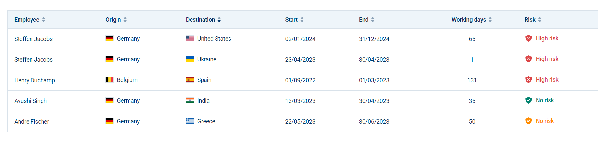

# WorkFlex Workation Platform

A full-stack application that displays workations in a sortable table. Built as part of the WorkFlex coding challenge.



## Technologies

| Layer | Stack |
|-------|-------|
| Backend | Java 21, Spring Boot 3.4, Spring Data JPA, Flyway, Lombok, springdoc OpenAPI |
| Frontend | Angular 19, TypeScript, SCSS |
| Database | MySQL 8 |
| Testing | JUnit 5, Mockito, Spring MockMvc, Jasmine/Karma |

## Project structure

```
workflex-challenge/
├── backend/                 # Spring Boot REST API
├── frontend/                # Angular SPA
├── docker-compose.yml       # MySQL for local development
├── docs/                    # Screenshots and reference material
└── workations.csv           # Source CSV (also copied to backend resources)
```

## Prerequisites

- JDK 21
- Maven 3.9+
- Node.js 20+ and npm 10+
- Angular CLI 19 (`npm install -g @angular/cli`)
- Docker Desktop (recommended for MySQL) or a local MySQL 8 instance
- Postman (optional, for API testing)

## Database setup

### Option A: Docker (recommended)

```bash
docker compose up -d
```

This starts MySQL on port `3007` with:

- Database: `workflex`
- User: `workflex`
- Password: `workflex`

### Option B: Local MySQL

Create the database and user manually:

```sql
CREATE DATABASE workflex;
CREATE USER 'workflex'@'localhost' IDENTIFIED BY 'workflex';
GRANT ALL PRIVILEGES ON workflex.* TO 'workflex'@'localhost';
FLUSH PRIVILEGES;
```

Connection settings are in `backend/src/main/resources/application.yml`.

## Running the application

### 1. Start the backend

```bash
cd backend
mvn spring-boot:run
```

On startup, Flyway creates the schema and the application imports `workations.csv` automatically when the database is empty.

API base URL: `http://localhost:8080`

**Swagger UI:** [http://localhost:8080/swagger-ui.html](http://localhost:8080/swagger-ui.html)

**OpenAPI JSON:** [http://localhost:8080/v3/api-docs](http://localhost:8080/v3/api-docs)

### 2. Start the frontend

```bash
cd frontend
npm install
npm start
```

Open `http://localhost:4200` in your browser.

## API endpoints

### `GET /workflex/workation`

Returns all workations from the database.

**Query parameters**

| Parameter | Required | Default | Description |
|-----------|----------|---------|-------------|
| `sort` | No | `employee` | Sort column: `employee`, `origin`, `destination`, `start`, `end`, `workingDays`, `risk` |
| `direction` | No | `asc` | Sort direction: `asc` or `desc` |

**Sorting behavior**

The table is sortable by **each column**, as required by the challenge. Sorting applies to **one column at a time** only: clicking a column header sorts by that field, and clicking the same header again toggles ascending/descending order.

Multi-column sorting (e.g. sort by employee, then by start date) was intentionally **not** implemented. It would add unnecessary complexity for this scope, and the challenge requirement is satisfied by making every column individually sortable.

Sorting is handled on the **backend** via the `sort` and `direction` query parameters. The Angular UI sends these when a column header is clicked.

**Example**

```http
GET http://localhost:8080/workflex/workation?sort=start&direction=asc
```

**Sample response**

```json
[
  {
    "workationId": "w1",
    "employee": "Steffen Jacobs",
    "origin": "Germany",
    "destination": "United States",
    "start": "02/01/2024",
    "end": "31/12/2024",
    "workingDays": 65,
    "risk": "HIGH"
  }
]
```

**Risk values**

| CSV/API value | UI label | Color |
|---------------|----------|-------|
| `HIGH` | High risk | Red |
| `LOW` | No risk | Yellow/Orange |
| `NO` | No risk | Green |

Dates are formatted as `dd/MM/yyyy` in API responses.

## API documentation (Swagger)

With the backend running, open Swagger UI in your browser:

```
http://localhost:8080/swagger-ui.html
```

Use it to explore the endpoint, try different sort parameters, and inspect the response schema interactively.

Raw OpenAPI specification:

```
http://localhost:8080/v3/api-docs
```

## Manual API testing

Start MySQL and the backend first, then use **Swagger**, **Postman**, or **curl** below.

### curl

**Get all workations (default sort by employee):**

```bash
curl -X GET "http://localhost:8080/workflex/workation"
```

**Sort by start date ascending:**

```bash
curl -X GET "http://localhost:8080/workflex/workation?sort=start&direction=asc"
```

**Sort by working days descending:**

```bash
curl -X GET "http://localhost:8080/workflex/workation?sort=workingDays&direction=desc"
```

**Sort by risk:**

```bash
curl -X GET "http://localhost:8080/workflex/workation?sort=risk&direction=asc"
```

**Invalid sort (expect HTTP 400):**

```bash
curl -X GET "http://localhost:8080/workflex/workation?sort=invalid"
```

**Pretty-print JSON in PowerShell:**

```powershell
curl.exe "http://localhost:8080/workflex/workation?sort=start&direction=asc" | ConvertFrom-Json | ConvertTo-Json
```

### Postman

Import the OpenAPI spec from `http://localhost:8080/v3/api-docs`, or send:

```
GET http://localhost:8080/workflex/workation?sort=risk&direction=desc
```

## Testing

### Backend

```bash
cd backend
mvn test
```

Includes:

- Unit tests for service, CSV import, and mapper logic
- Exception handler and custom exception tests
- Controller tests with MockMvc
- Integration test with H2 (imports CSV on startup)

## IntelliJ IDEA setup (Lombok)

This project uses **Lombok** on entities and configuration classes (`@Getter`, `@Setter`, `@Builder`, etc.).

### Important: import as a Maven project

Open the **repository root** (`workflex-challenge`) in IntelliJ, then:

1. If prompted, click **Load Maven Project** (or **Trust Project**)
2. If not prompted: open the **Maven** tool window → click **Reload All Maven Projects** (refresh icon)

You should see Maven modules: `workflex-challenge` → `workation-api` (backend).

If IntelliJ only shows a plain module without Maven dependencies, the root `pom.xml` was not imported — Lombok getters will not resolve and builds will fail.

### 1. Install the Lombok plugin

`Settings → Plugins → Marketplace → search "Lombok" → Install → Restart IDE`

### 2. Enable annotation processing

`Settings → Build, Execution, Deployment → Compiler → Annotation Processors`

- Check **Enable annotation processing**
- Set **Obtain processors from project classpath**

### 3. Set JDK 21 for the project

`File → Project Structure → Project → SDK → Java 21`

Also check **Modules → workation-api → Language level → 21**.

### 4. Reload Maven and rebuild

Maven tool window → **Reload All Maven Projects**  
Then **Build → Rebuild Project**

### Still failing? Delegate the build to Maven

`Settings → Build, Execution, Deployment → Build Tools → Maven → Runner`

- Check **Delegate IDE build/run actions to Maven**

Then run tests with Maven instead of the IDE compiler:

```powershell
cd backend
.\mvnw.cmd test
```

### Common IDE errors without Maven/Lombok configured

| Error | Cause |
|-------|-------|
| `cannot find symbol: method getWorkationId()` | Maven module not imported or Lombok not active |
| `cannot find symbol: method builder()` | Same as above |
| `cannot find symbol: method isEnabled()` | `@Getter` not processed on `CsvImportProperties` |

Services and controllers use **explicit constructors**; Lombok is used mainly on `Workation` and `CsvImportProperties`.

### Frontend

```bash
cd frontend
npm test
```

## Architecture decisions

- **Layered backend**: controller → service → repository, with DTOs at the API boundary (entities are never exposed).
- **CSV import on startup**: runs once via `ApplicationReadyEvent` when the table is empty, keeping seed data in version control.
- **Flyway migrations**: schema is versioned and reproducible across environments.
- **Backend sorting**: sorting is handled server-side via Spring Data `Sort`, which scales better and keeps a single source of truth. Only one sort column is active at a time; see **Sorting behavior** in the API section above.
- **Frontend modularization**: table, sort headers, country cells, and risk badges are separate standalone components.
- **OpenAPI / Swagger**: interactive API docs via springdoc, available at `/swagger-ui.html` during local development.
- **Flags via CDN**: country flags are loaded from [flagcdn.com](https://flagcdn.com) using a small country-name mapping utility.

## Assumptions

- CSV column `risk` uses values `HIGH`, `LOW`, and `NO` (matching the provided file).
- No authentication is required.
- The CSV file in `backend/src/main/resources/data/workations.csv` is the canonical seed data.
- MySQL is the primary database; H2 is used only for automated tests.

## Possible improvements

- Pagination and filtering on the API
- Multi-column sorting (e.g. employee + start date)
- Testcontainers for MySQL integration tests
- i18n for country names and labels
- Offline flag assets instead of CDN
- End-to-end tests with Playwright or Cypress

## Screenshot

The running application screenshot is at `docs/table-created-by-code.png`. A reference mockup from the challenge is available at `docs/reference-screenshot.png`.
